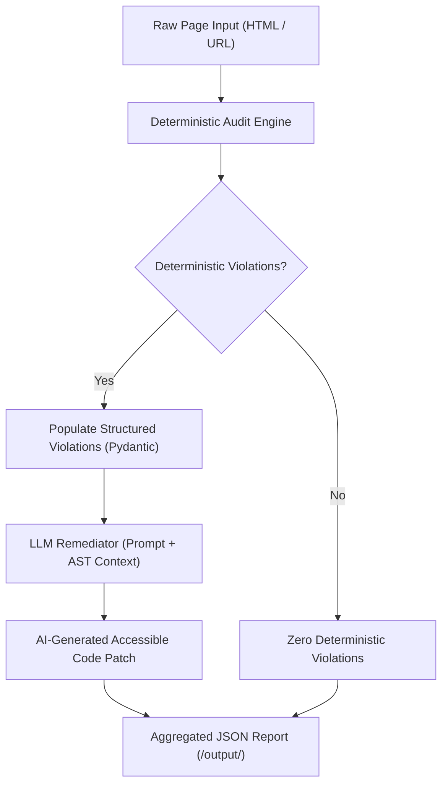

# WCAG 2.1 AA Accessibility & UI Regression Audit Rule Specification

## Executive Summary
This document defines the Day-1 audit rule specifications for the **AI Accessibility (WCAG) & UI Regression Auditor**. The engine combines high-precision deterministic static/computed DOM inspection with LLM-assisted cognitive accessibility heuristics to deliver zero-false-positive baseline auditing alongside intelligent contextual remediation.

---

## 1. Deterministic Audit Rules (6 Core Engine Rules)

Deterministic rules execute using strict DOM parsing, CSS computed-style calculations, and tree hierarchy algorithms. They guarantee 100% repeatability without model hallucinations.

### Rule 1: Missing Image Alternative Text
- **Rule ID**: `WCAG-1.1.1`
- **Standard**: WCAG 2.1 Criterion 1.1.1 Non-text Content (Level A)
- **Severity**: `Critical`
- **Scope**: All `` elements within the DOM.
- **Deterministic Detection Criteria**:
  - Element is an `` tag and has no `alt` attribute present (`has_attr('alt') is False`).
  - *Note*: `alt=""` is permitted for decorative images when paired with `aria-hidden="true"` or present in decorative context, but a missing `alt` attribute causes screen readers to read raw file paths.
- **Remediation**:
  - Add descriptive alternative text reflecting the image's function or content: ``.
  - For purely decorative elements, explicitly specify `alt=""` and `role="presentation"`.

---

### Rule 2: Missing Form Input Labels
- **Rule ID**: `WCAG-1.3.1` / `WCAG-3.3.2`
- **Standard**: WCAG 2.1 Criterion 1.3.1 Info and Relationships (Level A), Criterion 3.3.2 Labels or Instructions (Level A)
- **Severity**: `Critical`
- **Scope**: Interactive form controls: `<input>` (types other than `hidden`, `submit`, `reset`, `button`, `image`), `<select>`, `<textarea>`.
- **Deterministic Detection Criteria**:
  - Element lacks an associated `<label for="[id]">`.
  - Element is not nested inside an enclosing `<label>`.
  - Element lacks non-empty `aria-label` or `aria-labelledby` referencing an existing DOM node.
  - *Crucial note*: Relying solely on `placeholder="..."` fails WCAG 3.3.2 as placeholders disappear on user input and are ignored by many assistive tools.
- **Remediation**:
  - Provide an explicit `<label for="element-id">Descriptive Label</label>`.
  - Or supply a persistent `aria-label="Descriptive Label"`.

---

### Rule 3: Insufficient Color Contrast Ratio
- **Rule ID**: `WCAG-1.4.3`
- **Standard**: WCAG 2.1 Criterion 1.4.3 Contrast (Minimum) (Level AA)
- **Severity**: `Serious`
- **Scope**: Text nodes, buttons, badges, links, and actionable UI components against their computed background colors.
- **Deterministic Detection Criteria**:
  - Computes relative luminance ($L$) per sRGB WCAG definition:
    $$L = 0.2126 \times R + 0.7152 \times G + 0.0722 \times B$$
  - Contrast Ratio ($CR$):
    $$CR = \frac{L_1 + 0.05}{L_2 + 0.05}$$
  - **Normal text** (< 18pt regular or < 14pt bold): $CR < 4.5:1$ triggers a violation.
  - **Large text** ($\ge$ 18pt regular or $\ge$ 14pt bold): $CR < 3.0:1$ triggers a violation.
- **Remediation**:
  - Adjust foreground or background color tokens to reach at least 4.5:1 (e.g., replace muted text `#94a3b8` on `#ffffff` with `#475569` or darker).

---

### Rule 4: Heading Hierarchy Skips
- **Rule ID**: `WCAG-1.3.1`
- **Standard**: WCAG 2.1 Criterion 1.3.1 Info and Relationships (Level A)
- **Severity**: `Moderate`
- **Scope**: Heading tags `<h1>` through `<h6>` in sequential document order.
- **Deterministic Detection Criteria**:
  - Consecutive heading level difference exceeds $+1$ (e.g., `<h1>` followed directly by `<h4>` or `<h3>`, skipping intermediate levels `<h2>`).
  - Screen reader virtual heading lists become disjointed, leading to impaired mental models of document hierarchy.
- **Remediation**:
  - Restructure heading ranks sequentially (`<h1>` $\to$ `<h2>` $\to$ `<h3>`). Use CSS classes rather than heading tags for visual styling adjustments.

---

### Rule 5: Missing Document Language Declaration
- **Rule ID**: `WCAG-3.1.1`
- **Standard**: WCAG 2.1 Criterion 3.1.1 Language of Page (Level A)
- **Severity**: `Serious`
- **Scope**: Root `<html>` element.
- **Deterministic Detection Criteria**:
  - The root `<html>` element is missing a `lang` attribute, or `lang` attribute is empty or contains only whitespace.
  - Without `lang`, text-to-speech synthesizers cannot select appropriate pronunciation dictionaries and Braille translation tables.
- **Remediation**:
  - Add primary BCP 47 language code: `<html lang="en">` (or respective ISO language tag).

---

### Rule 6: Invalid ARIA / Non-Focusable Interactive Roles
- **Rule ID**: `WCAG-4.1.2`
- **Standard**: WCAG 2.1 Criterion 4.1.2 Name, Role, Value (Level A)
- **Severity**: `Critical`
- **Scope**: Elements with interactive ARIA roles (`role="button"`, `role="link"`, `role="checkbox"`, `role="tab"`, etc.) applied to non-interactive elements (such as `
`, ``, `<i>`).
- **Deterministic Detection Criteria**:
  - Element defines an interactive role but lacks `tabindex` (e.g., missing `tabindex="0"`), rendering it unreachable via keyboard Tab navigation.
  - Or element defines an empty accessible name (e.g., `<button>` with no inner text, no child `alt`, and no `aria-label`).
- **Remediation**:
  - Prefer native HTML interactive elements (`<button>`, `<a>`).
  - If custom elements are mandatory: add `tabindex="0"`, keyboard event handlers (`keydown` for Space/Enter), and explicit `aria-label`.

---

## 2. AI-Assisted Accessibility Rules (4 Intelligent Cognitive Rules)

These rules leverage LLM contextual awareness to evaluate subjective, semantic, and complex temporal interactions that cannot be resolved solely with static regular expressions or CSS selectors.

### Rule 7: Non-descriptive / Generic Alt Text Quality
- **Rule ID**: `WCAG-AI-1.1.1Q`
- **Standard**: WCAG 2.1 Criterion 1.1.1 Non-text Content (Level A)
- **Evaluation Mechanism**:
  - An LLM inspects the image URL, surrounding textual context, and existing `alt` string.
  - Flags generic placeholder values: `"image"`, `"picture"`, `"photo"`, `"icon"`, or raw filenames (`"IMG_20261120.png"`, `"graphic.svg"`).
  - Generates context-aware, informative descriptive text according to the specific user intent.

### Rule 8: Ambiguous Link & Button Context
- **Rule ID**: `WCAG-AI-2.4.4`
- **Standard**: WCAG 2.1 Criterion 2.4.4 Link Purpose (In Context) (Level A)
- **Evaluation Mechanism**:
  - Detects vague phrases: `"Click here"`, `"Read more"`, `"Learn more"`, `"More details"`, `"Download"`.
  - Analyzes the surrounding paragraph/sentence context using LLM comprehension.
  - Proposes self-describing replacement anchor text or `aria-label` enhancements (e.g., change `"Click here"` to `"Read our full WCAG 2.1 technical guidelines"`).

### Rule 9: Keyboard Focus Trap & Tab-Order Logic Analysis
- **Rule ID**: `WCAG-AI-2.1.2` / `WCAG-AI-2.4.3`
- **Standard**: WCAG 2.1 Criterion 2.1.2 No Keyboard Trap (Level A), 2.4.3 Focus Order (Level A), 2.4.7 Focus Visible (Level AA)
- **Evaluation Mechanism**:
  - Examines custom dialog overlays, modal traps, positive `tabindex` (> 0) disrupting natural DOM order, and destructive CSS like `outline: none !important;` without visual focus indicators.
  - Synthesizes keyboard focus-trapping escape vectors (e.g., ensuring `Esc` key dismisses modals and restores focus to triggering element).

### Rule 10: Semantic Landmark & UI Regression Layout Shift Evaluation
- **Rule ID**: `WCAG-AI-1.3.1L`
- **Standard**: WCAG 2.1 Criterion 1.3.1 Info and Relationships (Level A), UI Visual Consistency
- **Evaluation Mechanism**:
  - Verifies presence and nesting of ARIA / HTML5 landmark regions: `<header>`, `<nav>`, `<main>`, `<footer>`, `<aside>`.
  - Flags orphaned interactive widgets placed outside semantic landmarks.
  - Analyzes structural layout shifts between baseline versions to catch unintentional visual regressions that degrade keyboard/screen-reader navigation.

---

## 3. Violation Severity Matrix

| Severity | Definition | Impact on User | Example |
| :--- | :--- | :--- | :--- |
| **Critical** | Complete barrier preventing interaction or task completion. | User cannot submit form, identify control, or navigate interface. | Missing form labels, unfocusable `role="button"`. |
| **Serious** | Significant hindrance causing severe difficulty or confusion. | Content unreadable or requires extreme workarounds. | Contrast ratio < 3:1, missing document `lang`. |
| **Moderate** | Sub-optimal accessibility causing cognitive friction or navigational inefficiency. | Disrupted navigation flow or missing non-critical context. | Heading hierarchy skip (`h1` $\to$ `h4`), missing focus ring. |
| **Minor** | Best practice deviation with negligible barrier to entry. | Minor stylistic inconsistency or sub-optimal semantics. | Redundant landmark attributes on native elements. |

---

## 4. Remediation Workflow

